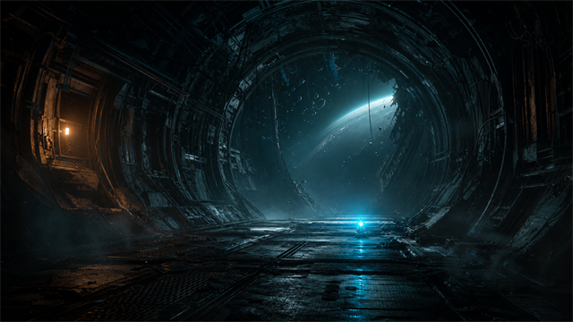

<p align="center">
  
</p>

# Dead Space (2008) Vortex Extension


-c41e1f)

**Vortex support for the original Dead Space (2008) on PC, by Rama2120.**
Discovers Steam, EA App, Origin, and custom installations across Windows drives,
then manages root-folder mods and TexMod package files through Vortex.

## Download

- [Nexus Mods](https://www.nexusmods.com/site/mods/2198)
- [Version 1.0.0 install ZIP](versions/v1.0.0/dead-space-2008-vortex-extension-1.0.0.zip)
- [SHA-256 checksum](versions/v1.0.0/dead-space-2008-vortex-extension-1.0.0.zip.sha256)

Version 1.0.0 adds numeric Nexus game ID **1656** for the current Vortex catalogue
process. Its `index.js`, artwork, and license notices are identical to 0.2.6.

## What it does

- Detects Steam App ID 17470 and common EA App/Origin installation layouts.
- Checks mounted Windows drives and validates original-game data folders.
- Rejects the Dead Space (2023) remake.
- Deploys compatible DLL, INI, ASI, ReShade, and other root-folder mods.
- Organizes `.tpf` files under `TexMod Packages`.
- Provides a one-time, user-approved folder-access repair for protected installs.

## Install

1. Install the ZIP from Vortex's **Extensions** page.
2. Restart Vortex when prompted.
3. Open **Games**, scan, and choose **Manage** for Dead Space.
4. Install, enable, and deploy mods normally.

TexMod or another compatible loader still performs `.tpf` texture injection.
Game files, TexMod, and third-party mods are not included. See the
[installation and troubleshooting guide](docs/INSTALLATION.md).

## Build and verification

On Windows with PowerShell and Node.js:

```powershell
.\tools\build.ps1
```

The build validates metadata, JavaScript syntax, artwork, ZIP structure, extracted
hashes, and existing regression tests against the packaged extension. Results,
the install ZIP, and its SHA-256 sidecar go to `../outputs`.
See [BUILDING.md](BUILDING.md) and [release verification](docs/RELEASE-VERIFICATION.md).
Package checks and read-only discovery checks do not replace gameplay testing.

## Version archive

| Version | Release evidence | Source evidence | Notes |
| --- | --- | --- | --- |
| [0.2.0](versions/v0.2.0) | Original ZIP unavailable locally | Retained package-validation snapshot | No replacement release ZIP invented. |
| [0.2.1](versions/v0.2.1) | Original ZIP, unchanged | Original working snapshot | EA discovery correction. |
| [0.2.2](versions/v0.2.2) | Original ZIP, unchanged | Original working snapshot | Folder-access checks. |
| [0.2.3](versions/v0.2.3) | Original ZIP, unchanged | Original working snapshot | Permission-flow correction. |
| [0.2.4](versions/v0.2.4) | Original ZIP, unchanged | Original working snapshot | Retained runtime baseline. |
| [0.2.5](versions/v0.2.5) | Original withdrawn ZIP, unchanged | Original extension snapshot | Experimental LAA helper; not the current baseline. |
| [0.2.6](versions/v0.2.6) | Original ZIP, unchanged | Matching retained snapshot | Existing notices and stable runtime. |
| [1.0.0](versions/v1.0.0) | Current ZIP and checksum | Current source at repository root | Adds `gameId`; runtime code unchanged. |

No original 0.1.0 package or source was found locally. No historical Git commits
or tags were reconstructed. Each version has generated archive checksums;
[BACKUP_INVENTORY.md](BACKUP_INVENTORY.md) records provenance and gaps.

## Credits and licensing

Created by Rama2120 with AI assistance. MIT licensed; see [LICENSE.txt](LICENSE.txt).
Existing attribution is retained in [THIRD_PARTY_NOTICES.txt](THIRD_PARTY_NOTICES.txt).
Unofficial community extension, unaffiliated with Electronic Arts or Nexus Mods.
